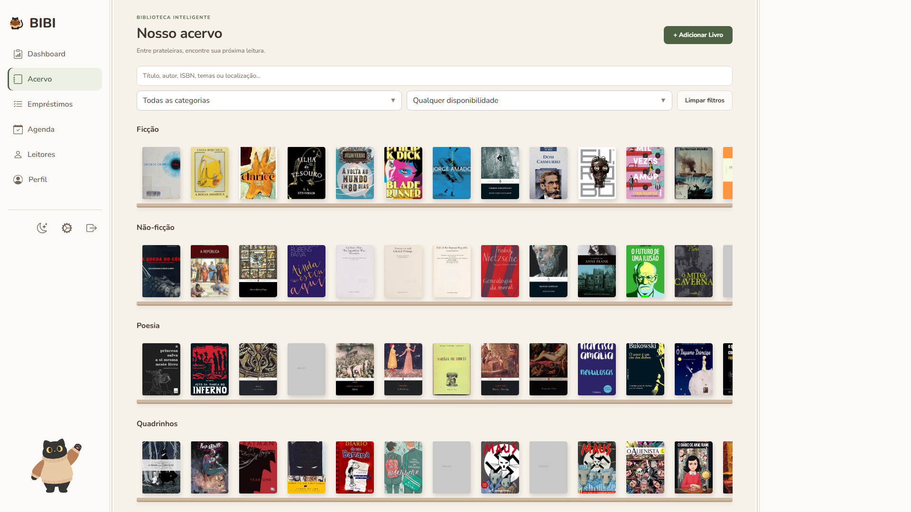
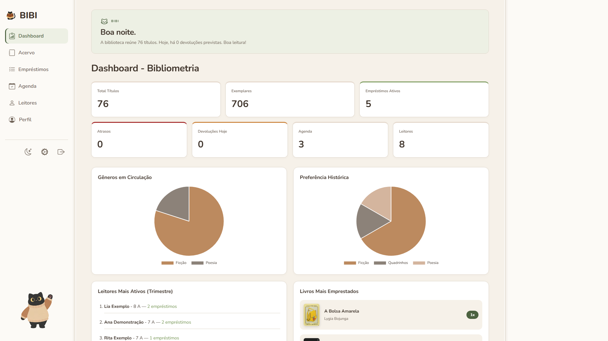
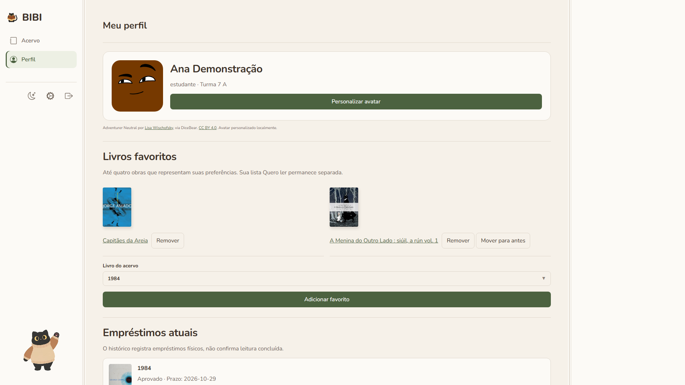
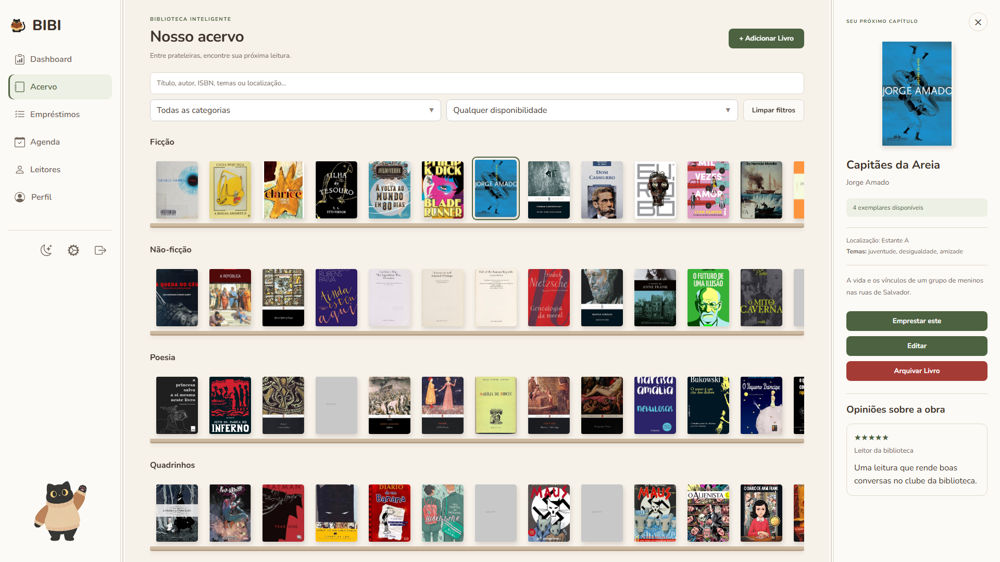
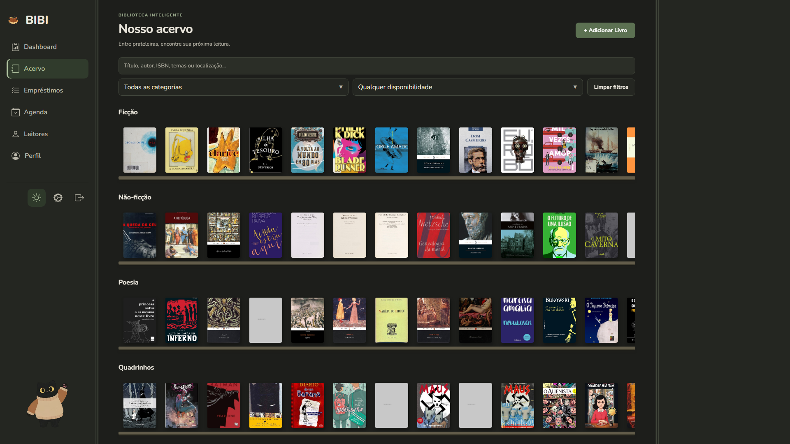
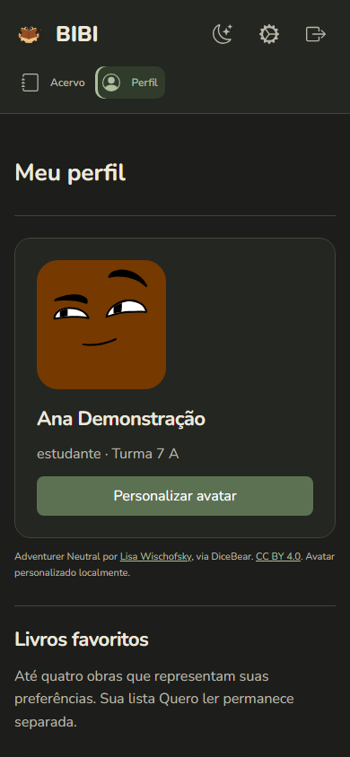

# BIBI — Biblioteca Inteligente

Uma plataforma para **gestão de bibliotecas escolares e incentivo à leitura**, com um espaço próprio para quem administra a biblioteca e para cada leitor.

A BIBI reúne o acervo, os empréstimos e a rotina da biblioteca em uma interface acessível pelo computador, tablet ou celular. Foi pensada para escolas, bibliotecários e professores que querem organizar a circulação dos livros e aproximar os estudantes da leitura.

[Versões e downloads](https://github.com/CaesarKairos/BIBI-Biblioteca-Inteligente/releases) · [Guia de operação](docs/GUIA_OPERACAO.md) · [Licença de uso](LICENSE)

## Conheça a BIBI

O computador da biblioteca guarda os dados e executa o aplicativo Windows. Nele, a equipe cadastra livros e leitores, acompanha os empréstimos e organiza os horários de uso do espaço. Os estudantes acessam suas contas pelo navegador, consultam o acervo e acompanham sua trajetória de leitura.

As capturas desta página mostram a aplicação em funcionamento com o **acervo da instalação local**. Contas e movimentações usadas na demonstração são fictícias, em uma instalação temporária separada. Nenhum banco, cadastro pessoal ou arquivo de capa do acervo acompanha o programa.

| Administração da biblioteca | Experiência do estudante |
| --- | --- |
|  |  |
| Indicadores de acervo e circulação em um só lugar. | Favoritos, empréstimos e registros pessoais de leitura. |
|  |  |
| Informações da obra, disponibilidade e avaliações. | Tema escuro para consultar e explorar o acervo. |

Veja também o perfil no celular

[Veja as demais telas e as condições da demonstração](docs/readme/README.md).

## O que você pode fazer

- **Organizar e pesquisar o acervo:** cadastre livros, autores, ISBN, temas, categorias, capas e localização nas prateleiras. Pesquise e consulte a disponibilidade dos exemplares.
- **Cuidar da circulação:** cadastre estudantes e professores, registre empréstimos, devoluções e renovações. Acompanhe reservas, pedidos de renovação e ocorrências como perda e reparo.
- **Oferecer contas individuais:** a biblioteca emite convites vinculados aos leitores cadastrados. Cada pessoa pode personalizar seu perfil e avatar, acompanhar empréstimos e receber notificações.
- **Acompanhar a leitura:** organize favoritos e a lista Quero ler, consulte o histórico de empréstimos e marque os livros lidos. Marcar uma leitura não registra uma devolução nem altera o estoque.
- **Compartilhar opiniões:** leitores podem avaliar e comentar obras. Comentários públicos não exibem nome ou contato do leitor; a equipe dispõe de ferramentas de moderação.
- **Administrar a rotina:** consulte o dashboard, organize a agenda da biblioteca e ajuste as regras de circulação. Configure o remetente de e-mail da escola quando desejar utilizar os envios.
- **Preservar os dados:** importe e exporte cadastros, crie backups e restaure a biblioteca pelas ferramentas do aplicativo. Guarde os backups em local protegido.
- **Ampliar a mediação de leitura:** ative a inteligência artificial opcional para conversas literárias, recomendações e apoio administrativo. As recomendações valorizam autoras brasileiras quando há metadados de autoria e fontes confirmadas no catálogo.

## Como instalar no Windows

A distribuição para usuários será disponibilizada na área [Releases / Versões do GitHub](https://github.com/CaesarKairos/BIBI-Biblioteca-Inteligente/releases). A preparação da versão 1.1.0 permanece em rascunho até a publicação pelos responsáveis; rascunhos não ficam disponíveis para download público.

1. Abra a área de versões e escolha uma versão publicada. Baixe o instalador Windows, quando disponível, ou o pacote portátil em ZIP. Os arquivos **Source code** são destinados ao desenvolvimento.
2. Execute o instalador e abra **BIBI** pelo Menu Iniciar. No pacote portátil, extraia o ZIP inteiro para uma pasta e abra `BIBI.exe`, mantendo a pasta `_internal` ao lado dele.
3. Na primeira abertura, cadastre a instituição e crie a primeira conta administrativa. Leia os termos e o aviso de privacidade apresentados e escolha seu avatar.
4. Cadastre o acervo e os leitores, ajuste as regras da biblioteca e emita convites para quem terá uma conta individual.

O pacote é destinado ao **Windows 10 ou 11 de 64 bits** e utiliza Microsoft Edge WebView2 para a janela do aplicativo. A homologação em uma instalação limpa do Windows ainda está pendente. O uso comum não exige instalar Python, Flask ou Node.js, nem executar comandos no terminal.

Os dados ficam em `%LOCALAPPDATA%\BIBI`, separados dos arquivos do programa. Antes de atualizar ou trocar de computador, faça um backup em **Configurações → Dados**. A versão distribuída começa sem livros, leitores ou contas predefinidas.

## Como outras pessoas acessam

O computador onde a BIBI está aberta funciona como **servidor da biblioteca** e precisa permanecer ligado. Nos demais dispositivos autorizados, basta abrir no navegador o endereço **HTTPS da rede local** exibido em **Configurações → Biblioteca**. Não é necessário instalar a BIBI em cada celular ou computador.

A conexão segura pode exigir a configuração do certificado da instalação nos dispositivos autorizados e a liberação do firewall da rede privada. A equipe de informática da escola pode seguir o [guia de rede local](docs/REDE_LOCAL.md). A instalação não torna o sistema automaticamente acessível pela internet.

## Inteligência artificial opcional

A BIBI funciona sem IA. O bibliotecário pode configurar serviços externos nas Configurações, testar a conexão e ativar os recursos quando forem adequados à instituição. Entre os serviços cadastrados, a BIBI seleciona automaticamente os modelos compatíveis e autorizados; o uso de modelos pagos depende da autorização da escola.

A IA auxilia a mediação da leitura, as recomendações literárias e a análise administrativa. As sugestões levam em conta o acervo e os interesses disponíveis, com valorização de autoras brasileiras documentadas, sem deduzir gênero ou nacionalidade pelo nome.

Esses recursos podem depender de internet, chave de API, limites, custos e condições do provedor. A escola deve avaliar quais informações serão enviadas aos serviços configurados. [Entenda a configuração e os limites da IA](docs/INTEGRACAO_IA.md).

## Tecnologias utilizadas

| Tecnologia | Papel na BIBI |
| --- | --- |
| Python e Flask | Servidor da aplicação e regras da biblioteca. |
| SQLite | Armazenamento local dos cadastros, contas e histórico. |
| HTML, CSS e JavaScript | Interface e interações no computador e no navegador. |
| PyWebView | Janela do aplicativo desktop no Windows. |
| Waitress e Cheroot | Servidores da arquitetura local e do acesso pela rede. |
| HTTPS | Proteção das conexões na rede local. |
| PyInstaller | Empacotamento do programa e das dependências no executável Windows. |
| Playwright | Testes automatizados da interface em navegador. |
| Provedores de IA | Integrações opcionais em nuvem para os recursos de inteligência artificial. |

## Sobre o projeto

A BIBI tem origem no contexto escolar e integra a iniciativa **Philocode**, voltada ao uso da tecnologia na educação. Seu objetivo é facilitar a organização das bibliotecas e incentivar a leitura, incluindo a valorização da produção intelectual feminina e da literatura de autoras brasileiras.

A autoria e as contribuições registradas no histórico do repositório incluem **Cesar Augusto (CaesarKairos)** e **Nicolly França**. Os créditos da Philocode e dos componentes de terceiros são preservados na aplicação. Os avatares Adventurer Neutral são de Lisa Wischofsky, via DiceBear, sob [CC BY 4.0](https://creativecommons.org/licenses/by/4.0/).

## Licença

A BIBI é um **software proprietário**, com todos os direitos reservados. A instalação e o uso da versão disponibilizada são gratuitos nas condições da [licença de uso](LICENSE), inclusive para atender a biblioteca pela rede local.

A disponibilidade do código para consulta não concede autorização geral para modificá-lo, criar versões derivadas ou redistribuí-lo. Essas ações exigem autorização prévia e expressa dos titulares. Configurar o aplicativo e cadastrar, importar ou exportar os próprios dados pelas ferramentas existentes são usos permitidos. Componentes de terceiros conservam suas próprias licenças.

## Documentação técnica

Para a equipe de informática e quem participa do desenvolvimento:

- [Instalação avançada, build e validação da distribuição](docs/DISTRIBUICAO.md)
- [Operação, contas, circulação e backup](docs/GUIA_OPERACAO.md)
- [Rede local, HTTPS e certificados](docs/REDE_LOCAL.md)
- [Arquitetura e desenvolvimento](docs/REFATORACAO.md)
- [Integrações e arquitetura da IA](docs/INTEGRACAO_IA.md)
- [Seleção automática de modelos](docs/ROTEAMENTO_IA.md)
