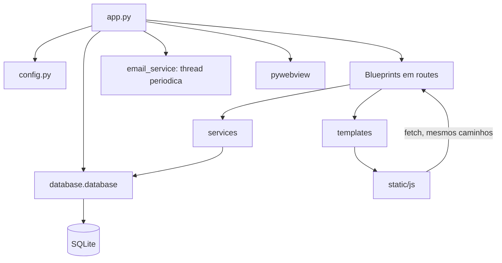

# BIBI modular: mapa e validacao

Refatoracao estrutural do projeto presente no workspace. O monolito original esta preservado integralmente em `legacy/app_monolitico.py`, exclusivamente como referencia e oraculo dos testes. Nao execute essa copia como uma segunda instalacao.

Foram preservadas 52 declaracoes de rota (alem da rota estatica do Flask), seus metodos, contratos JSON, protecoes de administrador, consultas e regras. O `app.py` passou de 5357 para 55 linhas. Nenhuma dependencia de producao foi adicionada e `requirements.txt` permanece intacto.

## Estrutura completa

Ambiente virtual, metadados Git e caches nao fazem parte da arvore de fontes. O arquivo `.env` e opcional, ignorado pelo Git e nao existia no workspace; nao foi criado nem preenchido com credenciais.

```text
BIBI-Biblioteca-Inteligente/
    database/
        __init__.py
        database.py
        schema.sql
    docs/
        inventario_original.json
        REFATORACAO.md
        template_bindings.json
    legacy/
        app_monolitico.py
        README.md
    routes/
        __init__.py
        admin.py
        agendamentos.py
        configuracoes.py
        emprestimos.py
        leitores.py
        livros.py
        pages.py
    services/
        __init__.py
        agendamentos_service.py
        configuracoes_service.py
        email_service.py
        emprestimos_service.py
        image_service.py
        leitores_service.py
        livros_service.py
    static/
        css/
            app.css
            landing.css
        images/
            externalcovers/
                placeholder.png
            hero/
                hero.jpg
                hero10.jpg
                hero11.jpg
                hero12.jpg
                hero13.jpg
                hero2.jpg
                hero3.jpg
                hero4.jpg
                hero5.jpg
                hero6.jpg
                hero7.jpg
                hero8.jpg
                hero9.jpg
            uploadedcovers/
                placeholder.png
            catwaving.webm
            icon.ico
            icon.png
            iconphilocode.png
            philocode.png
            placeholder.png
        js/
            agenda.js
            app.js
            configuracoes.js
            dashboard.js
            emprestimos.js
            landing.js
            leitores.js
            livros.js
            template.js
            ui.js
    templates/
        emails/
            confirmacao.html
            devolucao.html
            notificacao.html
            renovacao.html
        app.html
        index.html
    tests/
        __init__.py
        browser_check.py
        test_regression.py
    utils/
        __init__.py
        auth.py
        datetime.py
    .gitignore
    app.py
    config.py
    env.example
    README.md
    requirements.txt
    setup.iss.example
```

## Responsabilidades e imports

| Arquivo | Responsabilidade |
| --- | --- |
| `app.py` | Inicializar diretorios, banco e Flask; registrar Blueprints; iniciar notificacoes, servidor e janela pywebview. |
| `config.py` | Carregar `.env`, caminhos de desenvolvimento/instalacao, variaveis de e-mail e diretorios de dados. |
| `database/database.py` | `DatabaseManager`, conexoes SQLite com WAL, inicializacao, ALTER TABLE e valores padrao de configuracao. |
| `database/schema.sql` | As mesmas cinco tabelas, colunas, tipos, constraints e relacionamentos do original. |
| `routes/__init__.py` | Registrar Blueprints e converter resultados dos services em JSON HTTP. |
| `routes/*.py` | Receber parametros HTTP, aplicar decorators de acesso e delegar aos services. |
| `services/livros_service.py` | Cadastro, edicao, exclusao, listagem e busca em cascata Open Library -> BrasilAPI -> Google Books por ISBN -> fallback por titulo. |
| `services/leitores_service.py` | CRUD e autocomplete dos leitores. |
| `services/emprestimos_service.py` | Emprestar, devolver, renovar, atrasos, historico, indicadores e rankings. |
| `services/agendamentos_service.py` | Agenda, filtros, proximas datas, historico, criacao e exclusao. |
| `services/configuracoes_service.py` | Configuracoes persistidas, flags, quantidade de aulas, senha e credenciais de e-mail. |
| `services/image_service.py` | Upload, validacao de extensao, download, bytes de capas e escolha da imagem hero. |
| `services/email_service.py` | MIME, SMTP, imagens embutidas, mensagens e verificacao periodica. |
| `utils/auth.py` | `is_admin`, `admin_required`, verificacao do hash da senha. |
| `utils/datetime.py` | Data e hora de Brasilia, com UTC-3 fixo. |
| `templates/index.html` | Landing page `/`. |
| `templates/app.html` | Aplicacao `/app`, com as mesmas secoes e condicionais de administrador. |
| `templates/emails/*.html` | Conteudo original das quatro mensagens. CSS inline e preservado para compatibilidade com clientes de e-mail. |
| `static/css/landing.css`, `static/css/app.css` | Estilos das duas interfaces, incluindo declaracoes retiradas dos atributos dos templates. |
| `static/js/template.js` | Liga os eventos extraidos dos templates, preservando `this`, `event` e a possibilidade de substituir `onclick`. Le declaracoes CSS e restabelece `element.style` para manter os testes de visibilidade originais. |
| `static/js/app.js` | Estado compartilhado, listeners e inicializacao na mesma sequencia original. |
| `static/js/landing.js` | Alternar secoes da landing e carregar a imagem hero. |
| `tests/test_regression.py` | Comparacoes diferenciais de APIs, banco, migracoes, mensagens, templates e inicializacao. |
| `tests/browser_check.py` | Comparacao da interface no Chromium, usando Edge/Chrome instalado e dados temporarios. |
| `docs/inventario_original.json` | Inventario de rotas, funcoes Python/JS, secoes, modais, formularios logicos, fetch e arquivos estaticos. |
| `docs/template_bindings.json` | Rastreabilidade dos atributos extraidos, usada nos testes de equivalencia do HTML. |



O objeto `db_manager` e compartilhado e tem identidade estavel. `app.py` inicializa o banco antes de registrar as rotas. Os services recebem dados comuns (dicionarios, parametros, arquivos), nao importam `app.py` e nao dependem de `request` ou `jsonify`. O acesso SQLite ocorre pelo gerenciador; as consultas e transacoes permaneceram junto de suas operacoes, sem reescrita de SQL. O registro dos Blueprints atribui nomes internos como `livros.api_livros`; os caminhos HTTP permanecem iguais.

O renderizador de e-mails usa o Jinja ja fornecido pelo Flask, sem precisar de contexto Flask nas threads. A interpolacao sem escape automatico foi mantida para reproduzir exatamente os corpos MIME originais.

## Rotas por Blueprint

`HEAD` e `OPTIONS` automaticos continuam sendo fornecidos pelo Flask. A rota `/api/livros` continua aplicando a protecao de escrita dentro da operacao POST. As demais protecoes abaixo correspondem aos decorators originais.

| Blueprint / arquivo | Metodos | Caminho | Funcao | Admin por decorator |
| --- | --- | --- | --- | --- |
| `pages` | GET | `/` | `landing` | Nao |
| `pages` | GET | `/app` | `app_principal` | Nao |
| `pages` | GET | `/static/images/<path:filename>` | `serve_images` | Nao |
| `admin` | GET | `/api/admin/status` | `admin_status` | Nao |
| `pages` | GET | `/api/hero-image` | `hero_image` | Nao |
| `configuracoes` | GET | `/api/config/senha/status` | `senha_status` | Sim |
| `configuracoes` | POST | `/api/config/senha/definir` | `definir_senha` | Sim |
| `configuracoes` | POST | `/api/config/senha/verificar` | `verificar_senha` | Nao |
| `configuracoes` | GET | `/api/config/bloquear_email/status` | `bloquear_email_status` | Sim |
| `configuracoes` | POST | `/api/config/bloquear_email/set` | `set_bloquear_email` | Sim |
| `configuracoes` | GET | `/api/config/exigir_senha_emprestimo/status` | `exigir_senha_emprestimo_status` | Sim |
| `configuracoes` | POST | `/api/config/exigir_senha_emprestimo/set` | `set_exigir_senha_emprestimo` | Sim |
| `configuracoes` | GET | `/api/config/obrigar_localizacao_livro/status` | `obrigar_localizacao_livro_status` | Sim |
| `configuracoes` | POST | `/api/config/obrigar_localizacao_livro/set` | `set_obrigar_localizacao_livro` | Sim |
| `configuracoes` | GET | `/api/config/exigir_senha_agendamento/status` | `exigir_senha_agendamento_status` | Sim |
| `configuracoes` | POST | `/api/config/exigir_senha_agendamento/set` | `set_exigir_senha_agendamento` | Sim |
| `configuracoes` | GET | `/api/config/bloquear_excluir_agendamento/status` | `bloquear_excluir_agendamento_status` | Sim |
| `configuracoes` | POST | `/api/config/bloquear_excluir_agendamento/set` | `set_bloquear_excluir_agendamento` | Sim |
| `configuracoes` | GET | `/api/config/quantidade_aulas/status` | `quantidade_aulas_status` | Nao |
| `configuracoes` | POST | `/api/config/quantidade_aulas/set` | `set_quantidade_aulas_route` | Sim |
| `configuracoes` | GET | `/api/config/email/status` | `config_email_status` | Sim |
| `configuracoes` | POST | `/api/config/email/set` | `set_config_email` | Sim |
| `livros` | GET, POST | `/api/livros` | `api_livros` | Nao |
| `livros` | POST | `/api/upload` | `upload_imagem` | Sim |
| `livros` | GET | `/uploadedcovers/<filename>` | `uploaded_file` | Nao |
| `livros` | GET | `/externalcovers/<filename>` | `external_file` | Nao |
| `livros` | PUT | `/api/livros/<int:id>` | `editar_livro` | Sim |
| `livros` | DELETE | `/api/livros/<int:id>` | `excluir_livro` | Sim |
| `leitores` | GET | `/api/leitores` | `api_leitores` | Sim |
| `leitores` | GET | `/api/leitores/buscar` | `buscar_leitor` | Sim |
| `leitores` | POST | `/api/leitores` | `criar_leitor` | Sim |
| `leitores` | PUT | `/api/leitores/<int:id>` | `editar_leitor` | Sim |
| `leitores` | DELETE | `/api/leitores/<int:id>` | `excluir_leitor` | Sim |
| `emprestimos` | POST | `/api/emprestimos` | `realizar_emprestimo` | Sim |
| `emprestimos` | GET | `/api/emprestimos/ativos/count` | `contar_emprestimos_ativos` | Sim |
| `emprestimos` | GET | `/api/emprestimos/ativos` | `listar_emprestimos_ativos` | Sim |
| `emprestimos` | GET | `/api/emprestimos/todos` | `listar_todos_emprestimos` | Sim |
| `emprestimos` | GET | `/api/emprestimos/devolvidos` | `listar_emprestimos_devolvidos` | Sim |
| `emprestimos` | GET | `/api/emprestimos/devolucoes-hoje` | `listar_devolucoes_hoje` | Sim |
| `emprestimos` | GET | `/api/emprestimos/atrasos` | `listar_atrasos` | Sim |
| `emprestimos` | POST | `/api/emprestimos/<int:id>/devolver` | `devolver_emprestimo` | Sim |
| `emprestimos` | POST | `/api/emprestimos/<int:id>/renovar` | `renovar_emprestimo` | Sim |
| `emprestimos` | GET | `/api/emprestimos/mais-emprestados` | `listar_mais_emprestados` | Nao |
| `emprestimos` | GET | `/api/emprestimos/ativos-por-genero` | `listar_ativos_por_genero` | Nao |
| `emprestimos` | GET | `/api/emprestimos/historico-por-genero` | `listar_historico_por_genero` | Nao |
| `emprestimos` | GET | `/api/emprestimos/ranking-leitores` | `listar_ranking_leitores` | Nao |
| `emprestimos` | GET | `/api/livros/adormecidos` | `listar_livros_adormecidos` | Nao |
| `agendamentos` | GET | `/api/agendamentos` | `api_agendamentos` | Nao |
| `agendamentos` | GET | `/api/agendamentos/datas-com-agendamentos` | `datas_com_agendamentos` | Nao |
| `agendamentos` | GET | `/api/agendamentos/passados` | `agendamentos_passados` | Nao |
| `agendamentos` | POST | `/api/agendamentos` | `criar_agendamento` | Sim |
| `agendamentos` | DELETE | `/api/agendamentos/<int:id>` | `excluir_agendamento` | Sim |

## Funcoes JavaScript por arquivo

Os scripts sao classicos, compartilhando o escopo global usado pelas funcoes originais e pelos elementos criados dinamicamente. Nao foram convertidos em ES modules, nem encapsulados de forma a esconder funcoes chamadas pela interface. O inventario abaixo inclui a classe `CustomSelect`.

### `static/js/ui.js`

`CustomSelect`, `closeModal`, `confirmAction`, `getOpenModalId`, `initCustomSelects`, `openModal`, `showToast`, `tab`, `toggleTheme`, `triggerModalAction`, `verificarAdmin`

### `static/js/configuracoes.js`

`abrirConfiguracoes`, `abrirModalConfiguracoes`, `atualizarBloquearExcluirAgendamento`, `atualizarBloqueioEmail`, `atualizarExigirSenhaAgendamento`, `atualizarExigirSenhaEmprestimo`, `atualizarObrigarLocalizacao`, `carregarConfig`, `carregarConfigAgenda`, `salvarConfig`, `salvarConfigAgenda`, `salvarConfigGerais`

### `static/js/livros.js`

`aplicarFiltroAcervo`, `aplicarVisibilidadeCamposLivro`, `carregarAcervo`, `confirmarExclusaoLivro`, `editarLivroSelecionado`, `exibirPrateleiras`, `filtrarAcervo`, `handleClipboardPaste`, `openModalManual`, `previewCapaEdit`, `previewCapaManual`, `salvarEdicaoLivro`, `salvarLivro`, `salvarLivroManual`, `setupDragAndDrop`, `uploadCapa`, `uploadImageFile`, `verDetalhes`, `verificarObrigarLocalizacao`

### `static/js/leitores.js`

`aplicarFiltroLeitores`, `aplicarMascaraTelefone`, `buscarLeitoresAutocomplete`, `carregarLeitores`, `editarLeitor`, `excluirLeitor`, `exibirListaLeitores`, `filtrarLeitores`, `formatarSala`, `salvarLeitor`, `toggleLeitorTipo`

### `static/js/emprestimos.js`

`aplicarVisibilidadeCamposEmprestimo`, `confirmarEmprestimoRapido`, `devolverEmprestimo`, `emprestarSelecionado`, `filtrarEmprestimos`, `renovarEmprestimo`, `verificarExigirSenhaEmprestimo`

### `static/js/dashboard.js`

`carregarDashboard`, `carregarGraficoGeneros`, `carregarGraficoHistorico`, `carregarLivrosAdormecidos`, `carregarRankingLeitores`, `carregarTopLivros`

### `static/js/agenda.js`

`carregarAgenda`, `carregarAgendamentosPassados`, `carregarProximosAgendamentos`, `celulaAgendaClick`, `excluirAgendamentoAtual`, `excluirAgendamentoDetalhes`, `initFlatpickr`, `limparFormAgenda`, `navegarParaAgendamento`, `salvarAgendamento`, `verificarExigirSenhaAgendamento`

### `static/js/app.js`

Estado global, listeners de eventos, `window.onload` e coordenacao dos demais arquivos.

### `static/js/landing.js`

`showSection`, `carregarHeroImage`

### `static/js/template.js`

`initializeTemplate (57 handlers extraidos; contratos de style/onclick)`

Ordem em `/app`: Chart.js, CSS, DOM, Flatpickr, traducao pt, `template.js`, `ui.js`, `configuracoes.js`, `livros.js`, `leitores.js`, `emprestimos.js`, `dashboard.js`, `agenda.js` e `app.js`. O estado vindo do servidor (admin e quantidade de aulas) e passado por atributos `data-*`, sem JavaScript inline. Os 77 corpos de funcoes/classes extraidos foram comparados com o original. Listeners e variaveis compartilhadas ficaram em `app.js`. Os trechos de HTML criados dinamicamente por essas funcoes conservam seus contratos originais.

## Telas, modais, formularios e filtros

As secoes continuam dentro de `/app`: `dash`, `acervo`, `emp`, `age` e `lei`. Dashboard mantem indicadores, generos em circulacao, historico, ranking, mais emprestados e adormecidos. Nao foram criadas paginas independentes para essas secoes. A landing conserva inicio e sobre.

Modais preservados: `modalAddLivro`, `modalManualLivro`, `modalEditarLivro`, `modalLeitor`, `modalEmprestimoRapido`, `modalConfiguracoes`, `modalConfigAgenda`, `modalSenhaConfig`, `modalAtrasos`, `modalDevolucoesHoje`, `modalAgendamento`, `modalConfirmacao`, `modalDetalhesAgendamento`.

O original nao usa elementos `<form>` nessas telas: os formularios logicos sao conjuntos de inputs com botoes/listeners nos modais. Cadastro por ISBN, manual, edicao de livro, leitores, emprestimo rapido, agendamento, senha e configuracoes mantem seus IDs e validacoes. Filtros de acervo/leitores continuam no navegador; autocomplete usa `/api/leitores/buscar`; consultas de agenda recebem data/periodo; os filtros de emprestimos continuam consumindo os mesmos endpoints. A lista integral das chamadas `fetch` esta no inventario JSON.

## Banco e caminhos preservados

- Conexao: `DatabaseManager.get_connection()` em `database/database.py`, mantendo `PRAGMA journal_mode=WAL`.
- Schema: `database/schema.sql`, com o SQL original.
- Compatibilidade: os quatro `ALTER TABLE` e seus `except sqlite3.OperationalError` continuam em `DatabaseManager.init_database()`; os `INSERT OR IGNORE` continuam sem substituir configuracoes existentes.
- Tabelas: `Livros`, `Usuarios`, `Emprestimo`, `Agendamento`, `Configuracoes`. `Emprestimo.usuarios_id` referencia `Usuarios.id`; `Emprestimo.livros_id` referencia `Livros.id`. Chaves unicas, constraints e defaults nao foram remodelados.
- Banco em uso: `%LOCALAPPDATA%\BIBI\Biblioteca.db`.
- Capas reais: `%LOCALAPPDATA%\BIBI\uploadedcovers` e `%LOCALAPPDATA%\BIBI\externalcovers`. As URLs `/uploadedcovers/<filename>` e `/externalcovers/<filename>` permanecem iguais.
- `static/images/uploadedcovers` e `static/images/externalcovers` conservam seus placeholders; nao foram confundidos com as pastas gravaveis do usuario.
- Recursos: `static/images`, inclusive hero, logos, icones, placeholder e video, sem alteracoes.
- Instalacao congelada: recursos em `<diretorio do executavel>/_internal/static`, templates em `_internal/templates`; schema deve acompanhar o modulo `database`.
- `.env`, `SECRET_KEY`, `PORT`, `FLASK_DEBUG`, fallback `EMAIL_USER`/`EMAIL_PASSWORD` e credenciais persistidas em `Configuracoes` continuam com o comportamento original. Nenhuma credencial foi gravada ou exibida.

Regras preservadas: estudante empresta um livro por vez e nao pode ter outro emprestimo ativo associado ao e-mail; professor tem vencimento no mesmo dia. Renovacao soma sete dias para estudante e um para professor a partir do maior entre vencimento e hoje. Devolucao atualiza data/status e disponibilidade conforme o original. Agenda rejeita datas passadas e respeita senha/bloqueio de exclusao. Notificacoes mantem flags de tres dias e do dia do vencimento, atualizacao de atraso e intervalo de 1800 segundos. SMTP continua `smtp.gmail.com:587`, STARTTLS, com as mesmas credenciais e mensagens. A cascata mantem inclusive suas condicoes originais de retorno antecipado.

## Validacao executada

Ambiente: Windows, Python real 3.11.9 (apesar de o launcher estar registrado no caminho Python313), todas as versoes de `requirements.txt` instaladas em `.venv`. Playwright foi instalado apenas como ferramenta de validacao, sem entrar nas dependencias de producao.

```powershell
.\.venv\Scripts\python.exe -m unittest discover -s tests -v
.\.venv\Scripts\python.exe tests/browser_check.py
Get-ChildItem static/js/*.js | ForEach-Object { node --check $_.FullName }
```

- 12 testes automatizados passaram, comparando o monolito com a versao modular.
- Mapa de URLs/metodos equivalente; leitura de todos os endpoints GET da API em localhost, IPv6 e acesso remoto; OPTIONS, negacoes e respostas de erro.
- CRUD de livros/leitores, autocomplete, disponibilidade, limite de emprestimos, devolucao, renovacao, relatorios e estatisticas.
- Configuracoes, senha, persistencia de credenciais simuladas, bloqueios, quantidade de aulas e agendamentos.
- Igualdade de dados e metadados SQLite apos as operacoes; inicializacao repetida e migracao de bancos legados com linhas existentes.
- Upload, leitura de capas, arquivos estaticos e erros de arquivos inexistentes.
- Cascata de livros com respostas controladas; mensagens MIME e anexos comparados byte a byte com SMTP simulado.
- Flags e atualizacao de atraso; thread periodica verificada com intervalo original; contrato de inicializacao desktop (janela, URL, tamanho, servidor e notificacoes) comparado com mocks.
- HTML normalizado, corpos de funcoes JavaScript e CSS extraido comparados com o original; sintaxe Python/JavaScript validada.
- Edge headless: 13 estados administrativos e 6 estados publicos por versao, com igualdade de DOM, estilos calculados, geometria, tema, navegacao, modais e cadastro manual. Chart.js e Flatpickr reais foram carregados dos CDNs; fontes remotas usaram o mesmo fallback nas duas versoes.
- Nenhum erro JavaScript novo; acesso administrativo sem erros nos cenarios testados.
- Nenhum teste acessou o banco real: `LOCALAPPDATA` foi redirecionado antes de importar cada aplicacao. SMTP e APIs de livros foram simulados.

## Limites e problemas anteriores a esta refatoracao

1. **Acesso nao administrativo:** `static/js/livros.js`, funcao `aplicarVisibilidadeCamposLivro`, acessa `.style` de elementos dos modais administrativos que nao existem na versao publica. `static/js/app.js` chama essa funcao na inicializacao. O navegador confirmou o mesmo erro nas duas versoes: `Cannot read properties of null (reading 'style')`. Mantido para nao misturar correcao funcional com separacao arquitetural.
2. **Bancos muito antigos preenchidos sem `data_cadastro`:** em `database/database.py`, SQLite pode recusar `ALTER TABLE ... DEFAULT (date('now'))` por o default nao ser constante. O `except/pass` ja existia e foi preservado. O teste documenta a mesma limitacao e preservacao das linhas; nao foi inventada uma migracao nova.
3. **Nao validado ao vivo:** entrega SMTP real, disponibilidade atual das APIs de livros e janela nativa interativa do pywebview. O conteudo, as chamadas e a inicializacao foram testados com simulacoes. Nao foi gerado/instalado um executavel distribuivel.
4. **Cobertura visual:** comparacao em 1200x700 com fontes de fallback comuns, sem atestar todas as combinacoes de dados, tamanhos de tela e fontes externas. As regras responsivas originais permanecem no CSS.

A copia original permanece no repositorio para investigar divergencias e permitir uma homologacao real de SMTP, APIs e desktop antes de sua remocao.
